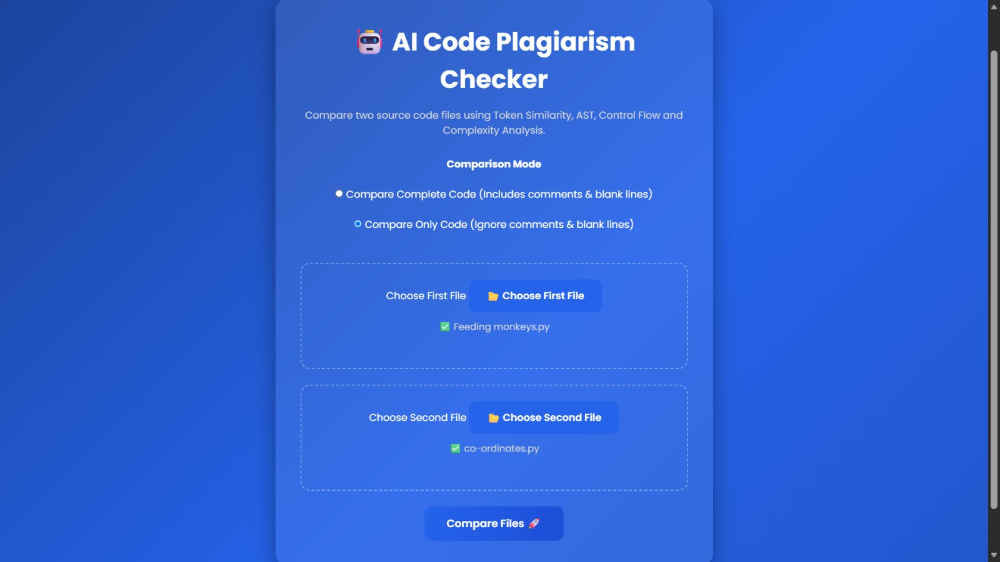
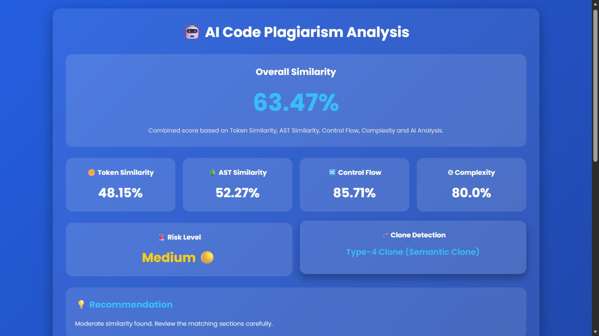
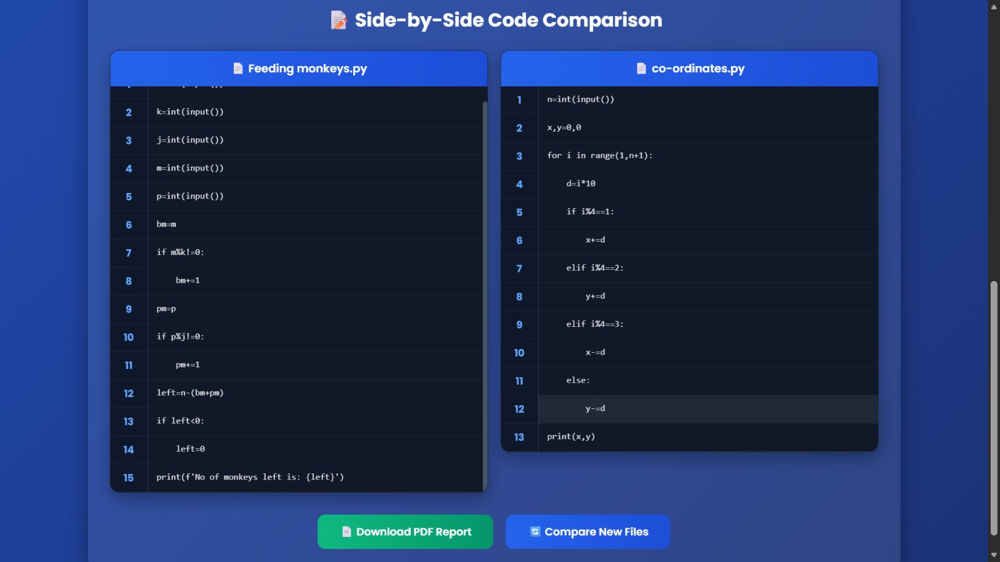
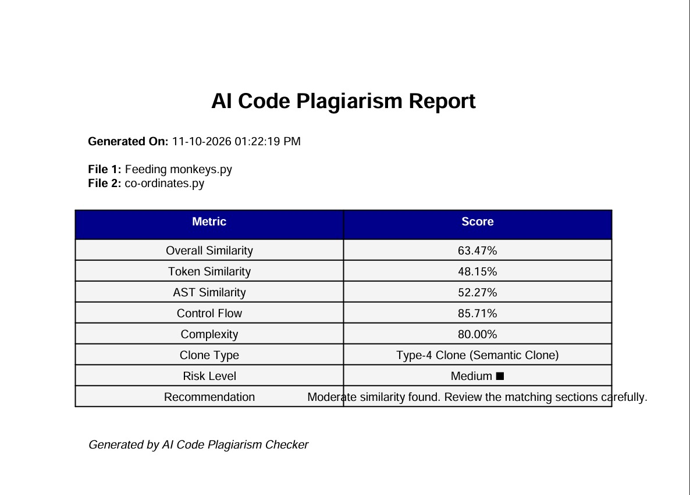

# 🤖 AI Code Plagiarism Checker

An AI-powered web application that compares two source-code files and analyzes their similarity using multiple code-analysis techniques. It generates an overall similarity score, plagiarism risk assessment, recommendations, and a downloadable PDF report.
# Project Structure

AI-Plag-Checker/
│
├── engine/
│   ├── ast_compare.py
│   ├── complexity.py
│   ├── control_flow.py
│   ├── embeddings.py
│   ├── clone_detector.py
│   ├── preprocessor.py
│   ├── risk.py
│   ├── scorer.py
│   └── token_similarity.py
│
├── templates/
│   ├── index.html
│   └── result.html
│
├── static/
│   ├── script.js
│   └── style.css
│
├── utils/
│   ├── highlight.py
│   └── report.py
│
├── app.py
├── requirements.txt
└── README.md

## 🚀 Features

- **Multiple Similarity Analysis:** Combines five code-analysis techniques.
- **Side-by-Side Code Comparison:** Displays both uploaded source-code files.
- **Clone Detection:** Identifies exact copies and potential code clones.
- **Risk Assessment:** Categorizes the detected plagiarism risk.
- **Recommendations:** Provides an interpretation of the comparison results.
- **PDF Report:** Generates a downloadable plagiarism analysis report.
- **Comparison Modes:** Supports comparing complete code or ignoring comments and blank lines.

## 🧠 How It Works

The application compares two source-code files using five techniques:

1. **Token Similarity:** Compares code tokens to identify matching programming elements while reducing dependence on formatting.
2. **AST Similarity:** Compares Abstract Syntax Trees to analyze similarities in code structure.
3. **Control-Flow Similarity:** Examines control-flow structures, such as branches and loops, to identify similar program logic.
4. **Code Complexity Similarity:** Compares estimated code complexity to identify similarities in structural complexity.
5. **AI Semantic Similarity:** Uses CodeBERT embeddings to estimate semantic similarity between code representations.

The individual scores are combined using a weighted scoring system to produce an overall similarity score. The application then provides a risk level, clone classification, and recommendation.

> Note: Similarity scores are indicators for reviewing code, not definitive proof of plagiarism.

## 🛠️ Tech Stack

- **Language:** Python
- **Web Framework:** Flask
- **AI Model:** CodeBERT
- **Machine Learning:** PyTorch, Transformers
- **Code Analysis:** Python AST and token-based analysis
- **Data Processing:** NumPy
- **PDF Generation:** ReportLab
- **Frontend:** HTML, CSS, JavaScript
- **Version Control:** Git and GitHub

## 📸 Screenshots

### 1. Home Page



### 2. Plagiarism Analysis Results



### 3. Side-by-Side Code Comparison



### 4. PDF Report




## ⚙️ Installation and Setup

### Prerequisites

- Python installed
- Git installed
- Internet connection for downloading required model files

### 1. Clone the Repository

```bash
git clone https://github.com/24x55a0513-git/AI-Plag-Checker.git
cd AI-Plag-Checker
```

### 2. Create a Virtual Environment

```bash
python -m venv venv
```

Activate it on Windows:

```powershell
.\venv\Scripts\Activate.ps1
```

### 3. Install Dependencies

```bash
pip install -r requirements.txt
```

### 4. Run the Application

```bash
python app.py
```

### 5. Open in Your Browser

Visit:

```text
http://127.0.0.1:5000/
```

## 📊 Output

The application provides:

- Overall similarity percentage
- Token similarity score
- AST similarity score
- Control-flow similarity score
- Complexity similarity score
- AI semantic similarity score
- Clone detection result
- Risk level and recommendation
- Downloadable PDF analysis report

## 🔒 Privacy and Limitations

- Use source-code files that you are authorized to analyze.
- Review the project's configuration before deploying it publicly.
- AI-based similarity scores can produce false positives or false negatives.
- Results should be interpreted alongside manual code review.

## 👨‍💻 Author

**Manoj Kumar**

GitHub: [AI-Plag-Checker](https://github.com/24x55a0513-git/AI-Plag-Checker)